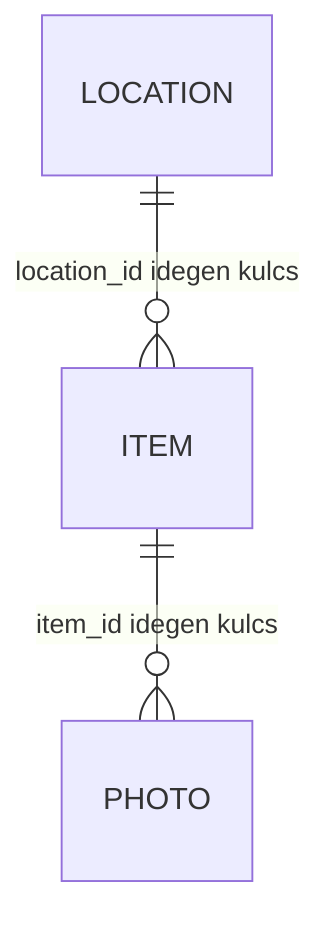

# Otthontár

Magyar nyelvű, helyi alkalmazás. Első modulja a költözési leltár. A háztartás közös adatokat használ egy Windows-gépen.

## Első indítás

1. A projektmappában kattints duplán az **Inditas.cmd** fájlra. A megnyíló böngészőben a **Beállítások** fülön add meg az első helyszín nevét, és kattints a **Mentés** gombra. Ismételd meg a többi helyszínnel.
2. A **Tárgyak → Új tárgy** oldalon add meg a tárgy nevét, válassz helyszínt, és válaszd ki a JPG-ket. A képek alatti gombokkal választhatsz borítót vagy kivehetsz egy új képet. A **Mentés** együtt rögzíti az adatlapot és a fotókat.
3. Az **Eladás** oldalon láthatod a Marketplace-re szánt tárgyakat. A hirdetést kézzel add fel. Az alkalmazásban forintban vezetheted az árakat.
4. Leállításhoz kattints duplán a **Leallitas.cmd** fájlra. A szolgáltatások a böngésző bezárása után is futnak. Az adatbázis és a képek megmaradnak.

A helyi cím [Otthontár](http://127.0.0.1:8740/leltar). A második indítás megnyitja a már futó példányt. Az első beállításkor működő Docker Compose esetén az indító a konténereket választja. Ezen a gépen előkészítettük a közvetlen windowsos indítást. A kiválasztott módot a gép megjegyzi, így a következő alkalommal is ugyanazt a leltárt látod.

A Beállítások fülön saját tárgyműveleteket adhatsz hozzá egyszerű jelölésként vagy célhelyszínes költöztetésként. A kikapcsolt művelet a korábbi tárgyakon megmarad. Az áthelyezést a tárgy adatlapján tervezheted meg. A Költöztetés fülön az indulási helyszín szerint is szűrhetsz. A Költöztetés végrehajtása gomb azonnal átvezeti a célhelyszínt, és leveszi a tárgyat a költöztetési listáról.

## MySQL megnyitása VS Code-ban

Nyisd meg a projektmappát a **File → Open Folder** paranccsal. Az SQLTools oldalsávban kattints az **Otthontár · csak olvasás** kapcsolatra. A kért jelszó a helyi `.local/personal/access.json` fájl **reader** mezője. Az adatok a 127.0.0.1 gépen, a 33316-os porton, az inventory adatbázisban vannak, a felhasználónév viewer. A kiszolgáló ellenőrzi a SELECT jogosultságot.

Nyisd le az inventory adatbázist, majd a Tables csomópontot. Az item táblán válaszd a rekordok megjelenítését (Show Table Records). A saját lekérdezéshez nyisd meg a [leltar.sql](docs/leltar.sql) fájlt, és futtasd az SQLTools **Run Query** parancsát. Az alsó eredménytáblában keresd meg a felvett tárgyat. Helyezd át a webes felületen, mentsd, majd futtasd újra a lekérdezést. A tárgy azonosítója azonos marad, a helyszín neve változik, a verziószám nő. A mindennapi módosításokat a webes felület végzi.

## Felépítés

A Thymeleaf közös oldalkeretet és a leltár sablonját szolgálja ki. A böngésző helyben őrzi a még szerkesztett mezőket és képeket. A Mentés a leltárszolgáltatásnak küldi el az űrlapot. A szolgáltatás egy MySQL-tranzakcióban ellenőrzi az adatlap verzióját és rögzíti az összetartozó adatokat. A külön imaging szolgáltatás HTTP-n fogadja a JPEG-et, ellenőrzi, és visszaad egy legfeljebb 420 pixeles előnézetet. Ennek a szolgáltatásnak nincs saját tartós adata. A leltárszolgáltatás tárolja mindkét fájlt és a hozzájuk tartozó azonosítót. Egy JPG legfeljebb 20 MiB, a teljes mentés legfeljebb 200 MiB lehet. Végleges törléskor az adatbázisban tartós törlési sor készül a képfájlokhoz. Átmeneti fájlhiba esetén a takarítás újraindítás után is folytatódik.

Az eladási mezők az item sorhoz tartoznak. Az item.cover a tárgy saját photo.id értékére mutató, mentéskor ellenőrzött hivatkozás. A fájlnevek a fotóazonosítóból származnak. Az imaging HTTP-kapcsolaton át kap képadatot. Az adatbázis-kapcsolatok mind az inventory szolgáltatáson belüliek.

## Helyi beállítás és fejlesztés

A gyökér pom.xml Maven-projektként importálható. A verify parancs egységteszteket és Java-formátumellenőrzést futtat. A formázás javítása a `mvn spotless:apply` paranccsal végezhető el. A gépen megtalálható Microsoft Extension Pack for Java tartalmazza a Java-hibakeresőt és Maven-támogatást. A helyi fordításhoz Java 21 vagy újabb JDK kell. Állítsd be a JAVA_HOME változót a választott JDK-ra. Maven 3.10.0-val a projekt gyökerében futtasd a `mvn verify` parancsot. Ezen a gépen a `powershell -ExecutionPolicy Bypass -File scripts/Build.ps1` a megfelelő JDK-t és Maven-t automatikusan kiválasztja. A helyi eszközpéldány ezen a gépen a `.local/apache-maven-3.10.0/bin/mvn.cmd`. Az Imaging és Inventory alkalmazás belépési pontjait az Imaging.java és Inventory.java tartalmazza. VS Code-ban a Java nézetben nyithatók meg. Hibakereséshez állítsd le az esetleg futó tesztpéldányt a `powershell -ExecutionPolicy Bypass -File scripts/Start.ps1 -TestRun -Stop` paranccsal. Indítsd újra a `-TestRun -Native -DebugServices -NoBrowser` kapcsolókkal. A VS Code Run and Debug menüben válaszd a Tesztleltár hibakeresése konfigurációt, jelölj ki töréspontot a Ledger.save metódusban, majd ments egy teszttárgyat a 18740-es porton. A képszolgáltatáshoz külön konfiguráció tartozik. A környezeti változók a két application.properties fájlban találhatók.

A natív profilban a képek és adatbázis a .local/personal mappában élnek. A teszt külön .local/acceptance mappát, 18740/18741-es HTTP- és 43316-os MySQL-portot használ. Dockerben a db és photos névvel ellátott köteteket a Compose projektnév különíti el. A futtatás során ne töröld a személyes profilt vagy a köteteket. Külön biztonsági mentés az első verzióban nincs.

Új Windows-gépen használd a Docker Desktop Linux-konténeres módját. A [Windowsos telepítési útmutató](https://docs.docker.com/desktop/setup/install/windows-install/) szerint ellenőrizd a virtualizáció és a WSL 2 támogatását, telepítsd és nyisd meg a Docker Desktopot. Amikor fut a motor, a `docker info` és a `docker compose version` parancs sikerrel lefut. Ezután az Inditas.cmd elvégzi a buildet és az inicializálást. Docker nélküli előkészítéshez csomagold ki a MySQL 9.7.4 Windows x64 ZIP-et a .local mappába mysql-9.7.4-winx64 néven, fordítsd le mindkét Maven-modult, majd futtasd az indítót. Ezen a gépen ez már megtörtént.

Az Actuator /actuator/health végpont mindkét szolgáltatásnál elérhető. A natív módban az inventory 8740-en, az imaging 8741-en figyel. Dockerben csak a web és a MySQL portja érhető el a gazdagépről, kizárólag a visszacsatolási címen. A JSON-naplók a helyi profilmappában inventory.log, imaging.log néven vannak, Dockerben a compose logs paranccsal láthatók. Az X-Request-Id válaszfejléc szerinti requestId mindkét szolgáltatás naplójában kereshető. A képhívás kapcsolódási határideje 3 másodperc, a teljes hívásé 30 másodperc.

## API és bővítés

| Hívás | Adatok és eredmény |
|---|---|
| GET /api/places | Helyszínek id és name mezővel |
| POST /api/places | JSON name és átnevezéskor id |
| GET /api/items?trash=false | Tárgyak helyszínnel és borítóazonosítóval |
| GET /api/items/{id} | Adatlap, verzió, fotók sorrendben |
| POST /api/items | Multipart draft JSON és ismételhető files mező. A Ledger.Draft a mezőszerződés. Új UUID-nál version=0, frissítéskor az utoljára olvasott verzió kell. |
| POST /api/items/{id}/{trash,restore,purge,move}?version=N | Verzióvédett Lomtár-művelet |
| GET /api/photos/{id}/{original,small} | JPEG |
| POST /thumbnail (imaging) | image/jpeg bemenet és JPEG válasz |

A hibás kérés 400, hiányzó tétel 404, ütközés 409, túl nagy feltöltés 413, hibás üzleti adat vagy JPEG 422, elérhetetlen képszolgáltatás 503 választ adhat. A kliens a hibánál megtartja a piszkozatot.

Új modulhoz az inventory/src/main/resources/templates/layout.html fájl főnavigációjához adj menüpontot, és hozz létre saját Thymeleaf-mappát az inventory sablonmappája mellett. Új útvonalat és vezérlőt külön Java-csomagban adj hozzá. Egy önálló üzleti szolgáltatás az imaging példájához hasonló Maven-modult, saját belépési pontot és compose.yaml szolgáltatásbejegyzést kaphat. Saját adattulajdon esetén külön séma és hozzáférés kell. A meglévő adatmodellt az inventory/src/main/resources/db/migration alatt következő sorszámú Flyway-migrációval bővítsd. A már lefutott V1 fájlt hagyd érintetlenül.

## Verziók és ellenőrzések

2026. november 13-án a Maven-build Spring Boot 4.1.2-t, Thymeleaf 3.1.5.RELEASE-t, Flyway 12.4.0-t és MySQL Connector/J 9.7.0-t oldott fel. A kapcsolt függőségeket a Spring Boot szülőprojekt rögzíti. A MySQL 9.7.4 LTS-vonalat a hosszabb támogatás miatt választottuk. A natív indító ezen a gépen a projekt saját JDK 25.0.5 LTS példányát használja. A Java 21 célszint a gépen telepített JDK-val és az újabb JDK-kkal is használható. A Docker-build a támogatott Maven 3.9.16 image-et használja. Források: [Spring Boot kiadás](https://spring.io/blog/2026/10/23/spring-boot-4-1-2-available-now/), [kompatibilitás](https://docs.spring.io/spring-boot/system-requirements.html), [MySQL kiadások](https://dev.mysql.com/doc/relnotes/mysql/9.7/en/), [Maven kiadások](https://maven.apache.org/docs/history.html), [Java kiadások](https://www.oracle.com/en/java/technologies/java-se-glance.html).

A böngészős átadási próba Windows alatt a tests/acceptance.cjs fájlban van. Node, Playwright Core és Edge szükséges hozzá. A PLAYWRIGHT_CORE és BROWSER_EXE változóval megadható saját telepítés is. Indítsd a tesztprofilt a `powershell -ExecutionPolicy Bypass -File scripts/Start.ps1 -Native -TestRun -NoBrowser` paranccsal, majd futtasd a `node tests/acceptance.cjs` parancsot. A próba saját teszttárgyakat és JPG-ket készít, és csak a tesztprofilt indítja újra. Az átadási követelményeket a projektprompt.txt tartalmazza.
